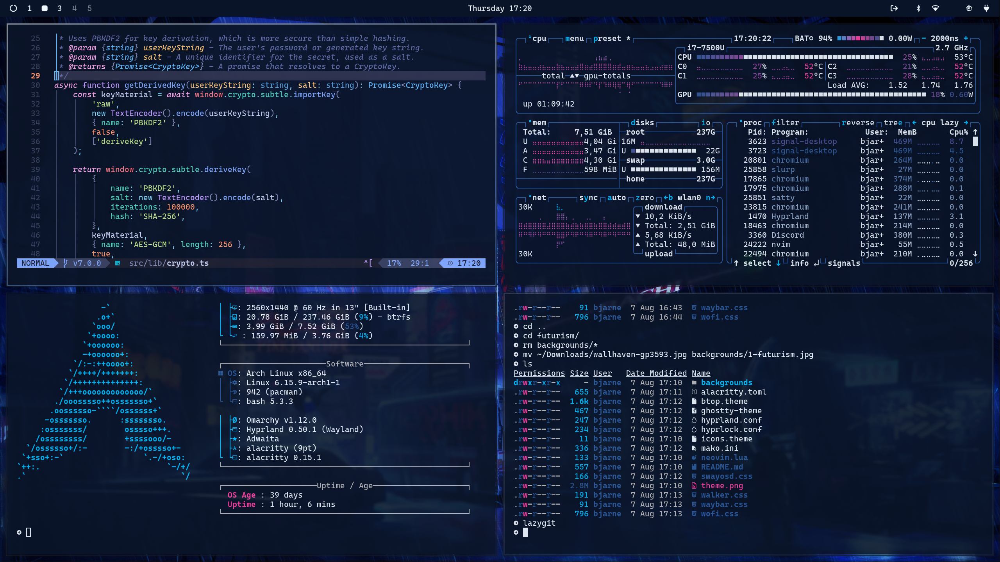

# Futurism

A neon blue and magenta theme for [Omarchy Quattro](https://github.com/omacom/omarchy).



## Install

```bash
omarchy theme install https://github.com/bjarneo/omarchy-futurism-theme
```

## Optional Neovim Theme

`neovim.lua` configures Tokyo Night Storm for manual use. Omarchy does not install Lua from third-party themes.
